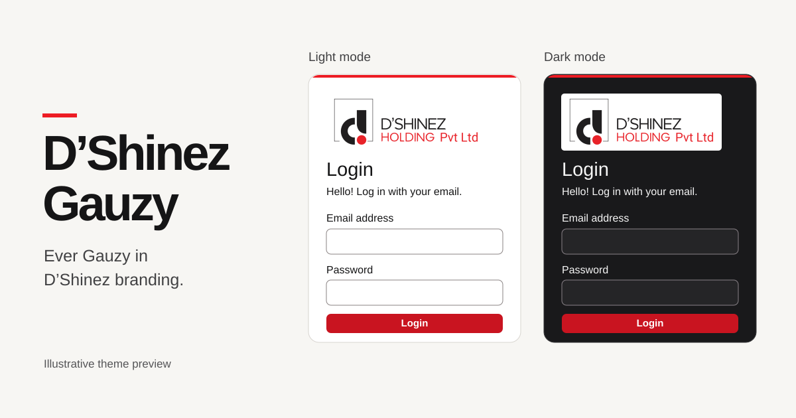

# D’Shinez Gauzy

The Ever Gauzy web workspace with the D’Shinez Holdings wordmark, red and black theme, and a first-run setup guide.



*Theme preview. [BRAG demo source](docs/demo/brag.html)*

## Start here

Install [Node.js 22 or newer](https://nodejs.org/en/download) and start [Docker Desktop](https://www.docker.com/products/docker-desktop/) or Docker Engine with Compose v2.20+. Open a terminal in the folder where you want your Gauzy project and paste this command.

```sh
npx --yes --package=https://codeload.github.com/sourav12368/dshinez-gauzy/tar.gz/9f809a7483494b87331f289417141023ffde6c1d -- dshinez-gauzy
```

1. Enter your admin email and choose a browser port, or press Enter for the defaults.
2. Wait while the installer pulls Ever Gauzy’s current `latest` images, applies the theme, and checks the application.
3. Follow the browser guide to sign in, configure your organization, and set up a test employee. The terminal shows your initial credentials.

The default app address is [http://127.0.0.1:4200](http://127.0.0.1:4200). Setup is local to this computer. Keep `dshinez-gauzy/.env` private and change the initial admin password after signing in.

## Day-to-day use

In the generated `dshinez-gauzy` folder, run `docker compose up -d` to start and `docker compose stop` to stop. Rerun the installer from the same parent folder to pull newer images. Database files and uploads are stored in Docker volumes.

[Theme and sync notes](docs/dshinez-branding.md) · [Installer source](https://github.com/sourav12368/dshinez-gauzy/tree/9f809a7483494b87331f289417141023ffde6c1d) · [Upstream README](README.upstream.md) · [License](LICENSES.md)
